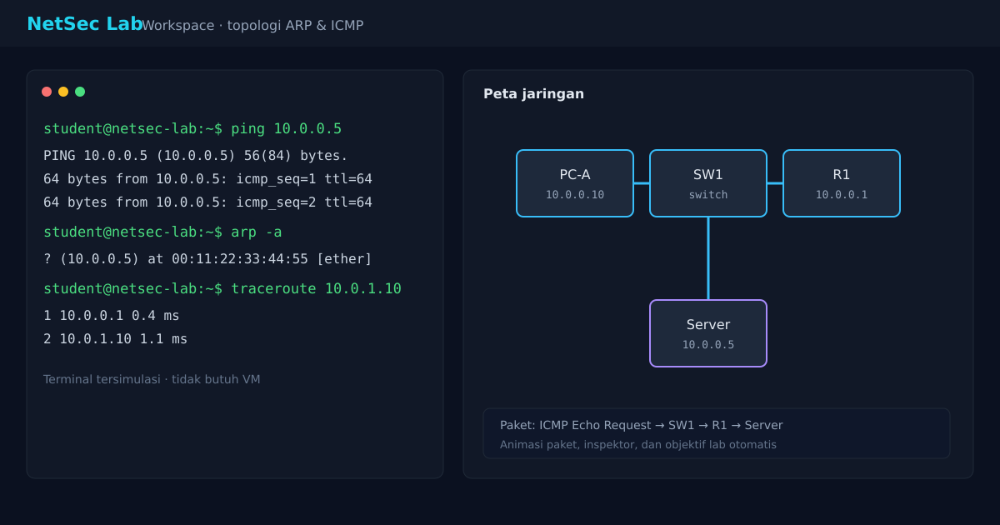

# NetSec Lab

Saya bikin NetSec Lab buat belajar jaringan komputer dan keamanan siber dari nol, dalam Bahasa Indonesia. Bedanya dengan tutorial biasa, di sini Anda bisa langsung ngetik perintah di terminal dan lihat paketnya lewat di peta jaringan. Semuanya jalan di browser, jadi tidak perlu VM, Docker, atau koneksi ke jaringan beneran.

**[Coba langsung: https://netsec-lab-lemon.vercel.app/](https://netsec-lab-lemon.vercel.app/)**



## Kenapa saya bikin ini

Waktu belajar jaringan, yang paling susah bukan hafal teori, tapi bayangin apa yang terjadi setelah tombol Enter ditekan. `ping` lewat mana dulu? Kapan ARP dipakai? Kenapa paket bisa hilang di router?

Jadi saya buat simulasi yang kasih umpan balik langsung. Terminal di kiri, peta di kanan, dan panel paket di bawah. Objektif lab dicek otomatis dari hasil perintah yang Anda ketik, jadi Anda tahu kapan sebuah lab benar-benar selesai.

## Yang ada di dalamnya

Sampai sekarang sudah ada 16 modul, 44 materi, dan 28 lab. Materinya dibaca seperti artikel, labnya langsung dipraktikkan.

Mesin simulasi di `src/engine/` ditulis dengan TypeScript murni, terpisah dari React. Yang sudah didukung:

- ARP, switching dengan MAC learning, routing longest-prefix, TTL, dan ICMP untuk `ping`/`traceroute`.
- VLAN dan trunk 802.1Q, NAT masquerade lewat `iptables` dan `conntrack`.
- TCP, UDP, DNS, DHCP, dan HTTP/HTTPS, lengkap dengan perintah seperti `dig`, `nslookup`, `curl`, `nc`, dan `ss`.
- Firewall `iptables`, `nmap`, `tcpdump`, hash `md5sum`/`sha256sum`, dan `john` untuk latihan dictionary attack.
- Lab web security: SQL injection dan XSS di aplikasi `toko.lab` dan `forum.lab`, plus versi amannya di `/v2`.
- CTF mini dengan 6 tantangan; flag disimpan sebagai hash SHA-256.

Semua perintah dijalankan oleh shell simulasi, bukan shell sistem. Skrip di tab browser tidak pernah dieksekusi — tab itu pakai iframe sandbox dan CSP.

## Menjalankan di laptop

```bash
npm install
npm run dev        # http://localhost:3000
npm test           # 127 test untuk engine, lab, dan konten
npm run lint
npm run build
```

## Struktur kode

```
src/
├─ app/
│  ├─ (site)/                 # halaman dengan header dan footer
│  │  ├─ page.tsx             # landing
│  │  ├─ learn/               # kurikulum dan materi MDX
│  │  ├─ lab/                 # daftar lab
│  │  ├─ dashboard/           # XP, level, progres
│  │  └─ tools/subnet/        # kalkulator subnet
│  └─ (workspace)/lab/[labId] # workspace lab layar penuh
├─ engine/                    # simulasi jaringan, tanpa React
│  ├─ core/                   # Network, Device, Packet, IP, L2/L3 forwarding
│  ├─ protocols/              # ICMP
│  ├─ shell/                  # shell Linux simulasi dan filesystem virtual
│  ├─ topology.ts
│  └─ lab.ts
├─ content/
│  ├─ curriculum.ts
│  ├─ lessons/                # materi MDX
│  └─ labs/                   # definisi dan solusi lab
├─ components/
│  ├─ lab/                    # terminal xterm.js, peta React Flow, inspektor paket
│  └─ learn/                  # komponen MDX: kuis, callout, diagram, kalkulator
└─ store/                     # state lab dan progres di localStorage
```

## Cara kerja simulasi

1. `execute()` di `engine/shell/shell.ts` mem-parsing perintah, termasuk pipe, redirect, `&&`, `;`, dan `sudo`.
2. Perintah jaringan memanggil engine (`Network.sendIp`, ARP, switching, routing, TTL), lalu menghasilkan timeline event: paket lewat link dan teks di terminal.
3. `store/lab-store.ts` memutar timeline itu sesuai kecepatan yang dipilih, sambil mencatat setiap paket di panel.
4. Tiap perintah juga menghasilkan fakta, misalnya `ping:ok:10.0.0.5`, yang dipakai lab untuk mengecek objektif.

## Menambah materi atau lab

Materi baru: daftarkan di `content/curriculum.ts`, tulis file MDX di `content/lessons/<modul>/`, lalu tambahkan ke `content/lesson-content.ts`.

Lab baru: buat `LabDefinition` di `content/labs/`, daftarkan di `content/labs/index.ts`, dan tulis solusi referensinya di `content/labs/labs.test.ts`.

## Deploy

Situs ini di-deploy di Vercel langsung dari repository GitHub. Setiap push ke `main` otomatis dibuild ulang. Tidak ada environment variable yang perlu diisi.

## Lisensi

MIT. Dibuat dan dipelihara oleh [@Emil-02](https://github.com/Emil-02).
